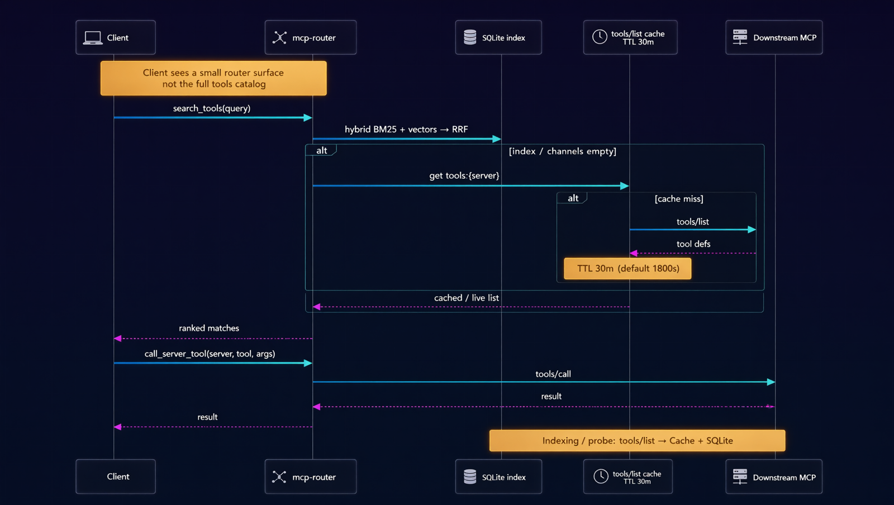

# mcp-router

[Русский](README.ru.md)



MCP proxy with lazy tool loading and hybrid search. Clients connect by URL only — no local MCP install on the agent host.

## Who it's for

- **Teams / ops** that run many MCP servers on a shared host and want one stable URL for Cursor, Claude Desktop, or other MCP clients.
- **Agent builders** who need dozens of tools without pasting every server into each client's config.
- **Not a replacement** for a single local MCP you already wire directly — use the router when the catalog grows or credentials must stay off the laptop.

## What

A single HTTP endpoint that:

- registers many downstream MCP servers (stdio / HTTP / SSE / WebSocket);
- indexes their tools into SQLite;
- exposes a small router surface (`search_tools`, `call_server_tool`, …) so agents find and call tools without loading every server up front.

## How it works

Runtime sequence (header diagram): hybrid search over the SQLite index, with a `tools/list` in-memory cache (TTL 30m) as fallback, then proxied `tools/call`.

Source: [`docs/diagrams/runtime-sequence.mmd`](docs/diagrams/runtime-sequence.mmd). Details: [`docs/ARCHITECTURE.md`](docs/ARCHITECTURE.md).

## Why (vs wiring MCP servers into the client)

| Direct MCP in the client | Via mcp-router |
|--------------------------|----------------|
| One config entry per server; every client repeats secrets and URLs | One URL; registry and secrets live on the router host |
| Client loads / lists all tools up front (context bloat) | Hybrid search (BM25 + vectors); call only what matches |
| Private / LAN-only servers need VPN or public exposure | Downstream stays on the router network; client only sees the proxy |
| Hard to share the same tool set across people and agents | Shared compose + `.env` + registry; optional Bearer + strict allow-list |

## Tech stack

| Layer | Choice |
|-------|--------|
| HTTP API | FastAPI + Uvicorn |
| Protocol | MCP Streamable HTTP (`/mcp`, optional strict `/mcp/v2`) |
| Index | SQLite + FTS5 (BM25) + sqlite-vec ANN (cosine fallback if sqlite-vec unavailable) |
| Embeddings | Remote OpenAI-compatible API **or** local fastembed |
| Downstream transports | stdio, HTTP, SSE, WebSocket |
| Deploy | Docker Compose; config via `.env` + `config/registry.json` |

**Vector search:** prefers sqlite-vec ANN. If sqlite-vec is missing or fails, falls back to brute-force cosine over stored embeddings, capped at **5000** rows (`BRUTE_FORCE_VECTOR_SCAN_LIMIT`) with a warning when the index is larger. Install sqlite-vec for unbounded ANN on big indexes.

## Quick start (Docker)

Defaults match `.env.example`: `HOST_PORT=8000`, container listens on `MCP_ROUTER_PORT=8000`.

```bash
cp .env.example .env
cp config/registry.json.example config/registry.json
# Edit .env (HOST_PORT, embeddings, API keys) and config/registry.json
docker compose up --build -d
curl "http://localhost:${HOST_PORT:-8000}/health"
```

Optional check: `curl "http://localhost:${HOST_PORT:-8000}/status"`.

Change the published port with `HOST_PORT` in `.env` (mapping is `${HOST_PORT}:${MCP_ROUTER_PORT}` in `docker-compose.yml`). Secrets and downstream URLs stay in `.env` and are substituted into `config/registry.json` as `${VAR}`.

## Configuration

| File | Role |
|------|------|
| `.env` | Ports, auth, CORS, embeddings, API keys (copy from `.env.example`) |
| `config/registry.json` | Downstream MCP servers (copy from `config/registry.json.example`; gitignored) |
| `config/aliases.json` | Optional RU/EN synonyms for search boost |

**Public SoT for registry:** `config/registry.json.example` (placeholders `${VAR}` only). Do not commit a live registry with private hostnames or secrets.

### Key environment variables

| Variable | Default | Description |
|----------|---------|-------------|
| `HOST_PORT` | `8000` | Host port published by `docker compose` |
| `MCP_ROUTER_HOST` | `0.0.0.0` | Bind address inside the process/container |
| `MCP_ROUTER_PORT` | `8000` | Listen port inside the process/container |
| `REGISTRY_PATH` | `config/registry.json` | MCP server registry |
| `INDEX_DB_PATH` | `data/tools.db` | SQLite index path |
| `ALIASES_PATH` | `config/aliases.json` | RU/EN server/tool synonyms |
| `SHADOW_RANKER` | `false` | Log weighted shadow ranking; agent still sees baseline RRF |
| `ALIAS_BOOST` | `1.35` | Score multiplier when query matches an alias |
| `EMBEDDING_URL` | — | With `EMBEDDING_MODEL`, use remote OpenAI-compatible API |
| `EMBEDDING_MODEL` | — | Remote embedding model (required with `EMBEDDING_URL`) |
| `LOCAL_EMBEDDING_MODEL` | `paraphrase-multilingual-MiniLM-L12-v2` | Local CPU model when URL not set |
| `ROUTER_API_KEY` | — | Optional Bearer token for `/mcp` and `/mcp/v2` |
| `ALLOWED_ORIGINS` | `*` | Comma-separated CORS origins |
| `STRICT_MCP_ENABLED` | `true` | Mount strict surface at `/mcp/v2` |
| `STRICT_ALLOWLIST` | — | CSV / JSON / path — curated tools for `/mcp/v2` |
| `STRICT_READ_ONLY` | `false` | On `/mcp/v2`, only `annotations.readOnlyHint=true` tools |
| `REINDEX_ON_START` | `true` | Reindex on startup |
| `REINDEX_BACKGROUND` | `true` | Non-blocking reindex |
| `REGISTRY_HOT_RELOAD` | `true` | Poll `registry.json` and reload without restart |
| `REGISTRY_POLL_INTERVAL_SEC` | `2.0` | Hot-reload poll interval (seconds) |
| `HEALTH_PROBE_ENABLED` | `true` | Periodic downstream `tools/list` probes |
| `HEALTH_QUARANTINE_ENABLED` | `true` | Mark/skip failed servers; block their calls |

## Security (public host)

Default CORS is `ALLOWED_ORIGINS=*` and DNS-rebinding protection is off — fine for a trusted LAN, **not** for a host reachable from the public internet.

If you expose mcp-router beyond a trusted network:

1. Set `ROUTER_API_KEY` and require `Authorization: Bearer …` on clients.
2. Set `ALLOWED_ORIGINS` to an explicit comma-separated allowlist (do not leave `*`).
3. Prefer `/mcp/v2` with `STRICT_ALLOWLIST` for untrusted clients so they only reach a curated subset of tools.

## Cursor config

Use `localhost` (or your hostname) and the same port as `HOST_PORT` in `.env` (default `8000`).

```json
{
  "mcpServers": {
    "mcp-router": {
      "url": "http://localhost:8000/mcp"
    }
  }
}
```

With Bearer auth:

```json
{
  "mcpServers": {
    "mcp-router": {
      "url": "http://localhost:8000/mcp",
      "headers": {
        "Authorization": "Bearer <ROUTER_API_KEY>"
      }
    }
  }
}
```

If `HOST_PORT=8010`, use `http://localhost:8010/mcp` instead.

## Router tools

Short agent guide for this surface: [`SKILL.md`](SKILL.md) (search → call, when to use status / review / feedback).

| Tool | Description |
|------|-------------|
| `get_router_status` | Health, index/reindex state, embedding mode, downstream probes, reconnect hints |
| `search_servers` | Discover registered downstream servers (not tools); returns `search_id` |
| `search_tools` | Hybrid search with confidence; results grouped for ranking convenience; returns `search_id` |
| `call_server_tool` | Proxy call with normalized result and typed remediation errors; returns `call_id` |
| `review` | Rate a prior `call_id` or `search_id` (`useful` / `partly` / `not_useful` / `not_sure`) |
| `feedback` | Local quality/friction/other report; optional `call_ids` / `search_ids` |

### Feedback / review (local only)

After `search_tools` / `call_server_tool`, agents can leave structured signals for the ranker:

- `review(usefulness=..., call_id=...)` or `review(..., search_id=...)` — exactly one target; optional `reason` (≤200 chars). Idempotent per target (`already_reviewed`).
- `feedback(category, message, call_ids?, search_ids?)` — categories: `quality`, `friction`, `other`. Missing audit refs do not reject; `verified_*` lists which ones joined.

Writes go to SQLite (`call_audit`, `reviews`, `feedback`) joined to `search_log`. **No downstream MCP call.** Queries/reasons redact bearer/API-key shaped secrets.

### Typed remediation errors

When `call_server_tool` fails (or search cannot run / index is degraded), the JSON includes actionable fields **without secrets or raw headers**:

| Field | Meaning |
|-------|---------|
| `failure_kind` | One of: `downstream_unreachable`, `auth_failed`, `index_degraded`, `tool_not_found`, `timeout` |
| `server_name` | Downstream server (when known) |
| `reconnect_hint` | What is wrong / where to look |
| `next_action` | Concrete next step for the agent (also mirrored as `retry_hint`) |
| `error_source` | Legacy coarse bucket: `router` / `downstream` / `tool` |

`search_tools` sets the same remediation fields when the index is pending, indexing, in error, or empty (`tool_count == 0`). Successful searches stay `ok: true` and only add hints when degraded.

Credentials stay on the router host (`.env` / registry headers) — error text redacts `Bearer`, `api_key`, and similar tokens.

## Registry format

Server-side `config/registry.json`: top-level `mcpServers` maps server names to transport configs. Optional `groups` only organize servers for convenience and ranking — they are not a separate product. Downstream servers must be reachable from the router host/container.

## CLI

```bash
pip install -e .
mcp-router serve              # HTTP server on :8000
mcp-router index-tools        # Rebuild SQLite index
```

## Development

After clone, run once:

```bash
./scripts/setup-dev.sh
```

Creates `.venv`, runs `pip install -e ".[dev]"`, and `pre-commit install`. Without that, git hooks are not installed.

Or manually:

```bash
python -m venv .venv && source .venv/bin/activate
pip install -e ".[dev]"
pre-commit install --install-hooks
```

Checks:

```bash
make check              # pre-commit (lint, typecheck, import-linter, tests)
make lint-imports       # import-linter layer contracts
make context-drift      # map changed sources → docs/context fragments
make test               # pytest
ruff check src tests    # lint
ruff format src tests   # format
mypy                    # typecheck
```

Pydantic models live in `src/mcp_router/models/` (`Registry`, `Settings`, `ToolMetadata`, etc.). Registry JSON is validated on load via `services/registry_loader.py`.

## Endpoints

| Path | Description |
|------|-------------|
| `GET /health` | Liveness |
| `GET /status` | tool_count, last_indexed_at, embedding status, search_quality, downstream_health probes, mcp_surfaces |
| `POST /mcp` | MCP Streamable HTTP — **full** surface |
| `POST /mcp/v2` | MCP Streamable HTTP — **strict** surface (allow-list / optional read-only) |
| `POST /admin/reindex` | Trigger background reindex |

### When to use `/mcp/v2`

Point safe / untrusted clients at `/mcp/v2` when they should only reach a curated subset of downstream servers/tools. Keep agents that need the full registry on `/mcp`.

Configure allow-list via env (wins) or `strictProfile` in `registry.json`:

```bash
# CSV: whole servers and/or server:tool keys
STRICT_ALLOWLIST=docs,web-search,wiki:lookup

# or JSON
STRICT_ALLOWLIST='{"servers":["docs","web-search"],"tools":[],"read_only":true}'
```

```json
{
  "strictProfile": {
    "servers": ["docs", "web-search"],
    "tools": ["wiki:lookup"],
    "readOnly": false
  },
  "mcpServers": { }
}
```

Calls outside the allow-list return typed `failure_kind=strict_denied` (same remediation shape as other router errors). Empty allow-list on `/mcp/v2` denies all `call_server_tool` until configured.

## Troubleshooting

- **Empty search results** — check `/status`: wait for `index_status: ready`, verify `EMBEDDING_URL` or use keyword fallback.
- **Downstream tool fails** — ensure server is in registry and env vars (`${VAR}`) are set in `.env`.
- **401 Unauthorized** — set matching `Authorization: Bearer` header in Cursor config.
- **stdio servers in Docker** — npx-based servers need Node in the image (included in Dockerfile).
- **`entrypoint.sh: no such file or directory` (Windows)** — CRLF line endings in shell scripts. Pull latest (`.gitattributes` + Dockerfile fix) and rebuild: `docker compose build --no-cache && docker compose up -d`.
- **Embedding / reindex errors** — if `EMBEDDING_URL` + `EMBEDDING_MODEL` set, uses remote API; otherwise local CPU (fastembed). Check `get_router_status` for mode and health.
- **Cursor `fetch failed` / ECONNREFUSED** — check container is up (`docker ps`), published port matches `HOST_PORT` in `.env` (default `8000` → `http://localhost:8000/mcp`), and `/status` shows `index_status: ready`.

## More docs

- [docs/ARCHITECTURE.md](docs/ARCHITECTURE.md) — current router layout (HTTP, SQLite search, transports)
- [docs/adr/0001-context-budget-invariants.md](docs/adr/0001-context-budget-invariants.md) — context-budget invariants + PR checklist
- [docs/context/](docs/context/) — focused design fragments tied to source files (`make context-drift`)
